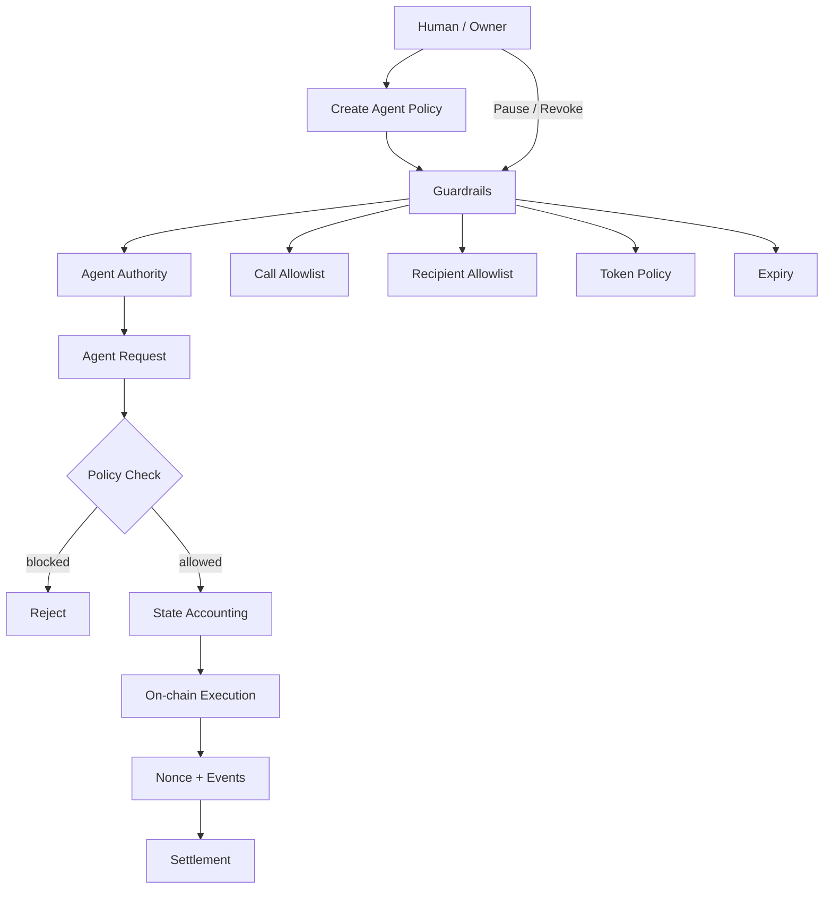
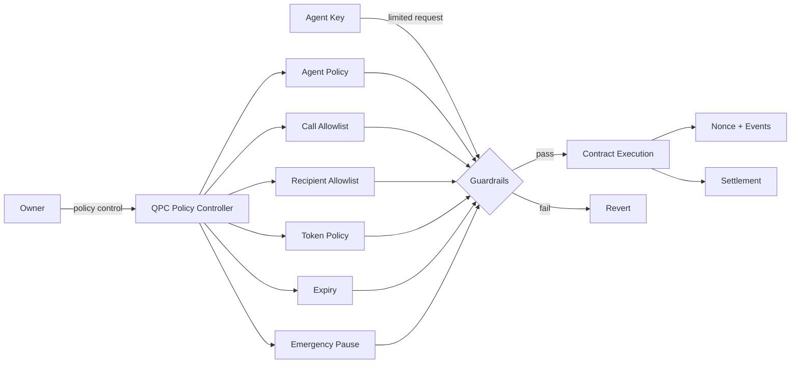

# QPC --- QUANTUM PERSISTENCE CONTRACT

<div align="center">

**Private On-chain Infrastructure for Agentic Finance**

**Human intent → Privacy-aware policy → Agent authorization → Private payment rail → Verifiable audit**

</div>

---

## About QPC

**QPC — Quantum Persistence Contract** is the long-term vision for a security-focused, privacy-oriented on-chain contract framework for autonomous agents and AI-assisted finance.

The initial ecosystem target is **NEAR**, with a modular architecture intended to support additional Layer 1 networks through chain-specific contract and wallet adapters. QPC is intended to give agents bounded authority to perform private payments and other approved actions while keeping control with the human or organization that owns the policy.

The core principle is:

> **An agent may act only within an explicit policy; it never becomes the owner or root authority.**

QPC's intended security model combines least-privilege authorization, spending limits, expiry, revocation, replay protection, secure key handling, privacy-preserving payment design, and independent security verification. The goal is to reduce attack surface and resist known classes of vulnerabilities—not to claim that any contract can be made immune to hackers or bugs.

### Privacy and agent payments

QPC is intended to support private agent-to-agent and agent-to-service payments, including payment flows that use **x402**. x402 is a payment protocol/interface; it does not make a payment private by itself. Privacy must be provided by the selected chain, wallet, cryptographic protocol, and payment adapter. The integration must state what is hidden, what remains public, and what metadata may still leak.

### Quantum-resilience objective

Quantum resistance is a design objective, not a currently implemented property. QPC will require a reviewed post-quantum cryptography strategy, including standardized algorithms and chain-compatible key/signature verification, before any component can be described as post-quantum secure. The current Solidity contract does not implement ML-DSA, SLH-DSA, or another post-quantum signature scheme.

### Current repository status

This repository contains an **EVM/Solidity policy-contract prototype** with Foundry tests and a first **NEAR-native Rust policy-gate source prototype** under `near/qpc-policy/`. The NEAR prototype authorizes and accounts for payment intents but does not transfer assets. Its Rust tests and WASM build are pending CI verification. Neither implementation provides shielded settlement, an end-to-end x402 adapter, universal multi-L1 execution, or post-quantum verification. The NEAR prototype is not yet suitable for real funds.

### Optional confidential inference with NEAR AI Cloud

QPC can optionally use NEAR AI Cloud for confidential off-chain agent reasoning. The integration must select a **Private TEE** model and verify fresh attestation plus response signatures using the supported SDK/verifier. Model output remains untrusted input: QPC's deterministic policy checks and chain authorization remain authoritative.

This does not make NEAR payments private and does not replace a shielded settlement rail. External-provider/Incognito models are not equivalent to Private TEE inference. The macOS NEAR AI Gateway app is for developer sessions; a deployed QPC service would integrate with the Cloud API/SDK directly. See the detailed requirements in the [hackathon specification](docs/QPC_NEAR_HACKATHON_SPEC.md#7a-near-ai-cloud-integration--confidential-agent-inference).

## NEAR Hackathon — Open Innovation

**Primary track:** Open Innovation (`open`)  
**Potential additional tracks:** Privacy & Private AI (`privacy`), AI Security & Defense (`security`), Agent Economy (`agents`).

QPC's Open Innovation proposal combines human-bounded agent authority, privacy-policy-aware payment routing, and chain-specific settlement. Its key safety property is **fail-closed privacy**: if a payment requests a shielded/private rail and no verified compatible rail is available, QPC rejects or holds the request rather than silently sending a transparent payment.

Additional tracks should only be selected in the final submission if the public demo genuinely demonstrates their requirements. A roadmap item alone is not a working feature.

The NEAR-first hackathon design and acceptance criteria are documented in [QPC_NEAR_HACKATHON_SPEC.md](docs/QPC_NEAR_HACKATHON_SPEC.md). The document is a design specification, not evidence that the NEAR contract, private settlement rail, x402 adapter, or post-quantum verification has already been implemented.


## Core workflow



### Execution path

**Configure → Activate → Request → Validate → Account → Execute → Emit event**

1. Owner configures an agent.
2. Agent receives limited authority.
3. Agent submits an execution request.
4. Contract checks expiry, pause state, target, selector, recipient and spending limits.
5. Spending accounting is updated.
6. The approved call or token transfer executes.
7. Nonce and event data provide an on-chain execution trail.
8. Owner can pause or revoke authority at any time.

---

## Security architecture



### Security boundaries

| Layer | Responsibility |
|---|---|
| Owner | Creates, changes, pauses and revokes policies |
| Agent | Requests permitted execution only |
| Policy | Defines limits and permissions |
| Contract | Enforces policy deterministically |
| Nonce | Provides monotonic execution sequencing |
| Events | Provide an on-chain audit trail |
| Pause | Emergency global execution stop |
| Expiry | Automatic authority termination |
| Reentrancy guard | Prevents nested execution |

AI logic is **not trusted as a security boundary**. The smart contract remains the final enforcement layer.

---

## Project structure

```
qpc_contracts/
├── docs/
│   └── QPC_NEAR_HACKATHON_SPEC.md  # NEAR-first hackathon technical specification
├── contracts/
│   └── QPCAgentFinance.sol       # Core policy + execution contract
│
├── test/
│   ├── QPCAgentFinance.security.t.sol
│   │                              # Security regression tests
│   ├── QPCAgentFinance.invariant.t.sol
│   │                              # State/invariant checks
│   └── QPCAgentFinance.stateful.t.sol
│                                  # Stateful handler scenarios
│
├── script/                        # Deployment scripts
├── foundry.toml                   # Foundry compiler/test configuration
├── README.md                      # Architecture + usage overview
└── ARCHITECTURE.md                # Detailed system design
```

The repository keeps the **security-critical policy layer small and isolated**. Application-specific agents, APIs, wallets and protocol adapters can be built above it later without changing the core security model.

---

## Policy model

### Native assets

Each agent receives:

- maximum policy duration: **30 days**
- total native spending cap
- per-transaction native limit
- active / revoked state

### ERC-20 assets

Each agent/token pair can define:

- cumulative token cap
- per-transaction token limit
- cumulative spending accounting

### Contract calls

Calls require an explicit:

**agent + target + function selector**

allowlist entry.

### Token recipients

Token transfers require an explicit:

**agent + recipient**

allowlist entry.

---

## Owner lifecycle

```
Create Policy
     ↓
Activate Agent
     ↓
Agent Executes
     ↓
 ┌───────────────┐
 │ Active Policy │
 └───────────────┘
     ↓
  Pause / Revoke / Expire
     ↓
Authority Ends
```

The owner remains the root authority throughout the lifecycle.

---

## Agent execution lifecycle

```
Agent
  │
  ▼
Request
  │
  ▼
Is active?
  │ no ─────► Revert
  │ yes
  ▼
Is paused?
  │ yes ────► Revert
  │ no
  ▼
Policy validation
  │
  ├── expiry
  ├── target + selector
  ├── recipient
  ├── per-tx limit
  └── cumulative cap
  │
  ▼
Accounting
  │
  ▼
On-chain call
  │
  ▼
Nonce + event
  │
  ▼
Settlement
```

---

## Security status

Current defenses include:

- two-step ownership transfer
- agent expiry
- native spending caps
- native per-transaction limits
- ERC-20 spending caps
- ERC-20 per-transaction limits
- target/function-selector allowlisting
- recipient allowlisting
- emergency pause
- monotonic nonce
- reentrancy protection
- defensive ERC-20 transfer handling
- policy validation
- security regression tests
- invariant/stateful test scaffolding

This repository has **not been independently audited**. Passing local or CI tests does not constitute a security audit. Production funds should not be deployed until independent review, fuzzing, static analysis and deployment validation are complete.

---

## Development

```bash
forge build
forge test
```

The intended development loop is:

**Change → Build → Security tests → Invariant/stateful tests → Review → Deploy**

---

## Roadmap — planned, not yet implemented

The roadmap is modular. Each item remains **planned** until its code, tests, threat model, and integration evidence exist.

1. **NEAR-first private-contract research and prototype:** design a NEAR-native implementation and evaluate the actual privacy guarantees available from the chosen execution and cryptographic architecture. The current Solidity contract is not deployable to NEAR as-is.
2. **Security engineering:** threat modelling, secure authorization, key lifecycle, replay protection, input validation, reentrancy/authorization review where applicable, fuzzing, invariant testing, static analysis, and independent audits. Security controls reduce risk; they cannot guarantee immunity from every exploit or bug.
3. **Private agent payments:** design agent-to-agent and agent-to-service payment flows with explicit privacy properties, recovery rules, and auditable authorization.
4. **x402 integration:** add a payment adapter that can interpret/serve x402 payment requests and route approved payments through a supported chain/wallet rail. x402 itself is not a privacy layer; private settlement depends on the underlying rail.
5. **Multi-L1 expansion:** add chain-specific adapters and contract implementations. “Support for all L1s” is an architectural aspiration, not a claim that every L1 can share one contract or one privacy/security model.
6. **Post-quantum readiness:** evaluate standardized post-quantum signatures and key-agreement choices, chain verification constraints, migration, hybrid transition, and cryptographic agility. No post-quantum protection is active in the current contract.

A conceptual future architecture:

```
Human / Agent
      │
      ▼
Policy + Authorization Layer
      │
      ▼
QPC chain adapter interface
      │
      ├── NEAR implementation       [PLANNED FIRST TARGET]
      ├── EVM-compatible L1 adapter  [PROTOTYPE EXISTS; NOT UNIVERSAL]
      ├── Other L1 adapters          [PLANNED]
      │
      ▼
Privacy-preserving payment rail    [PLANNED]
      │
      ├── Agent-to-agent payments
      ├── Agent-to-service payments
      └── x402 payment adapter
```

Privacy, security, and quantum-resilience properties must be evaluated independently for every chain and adapter. A feature on one network must not be presented as available on another without implementation and verification.

---

<div align="center">

**Policy first. Agent second. Settlement last.**

</div>
