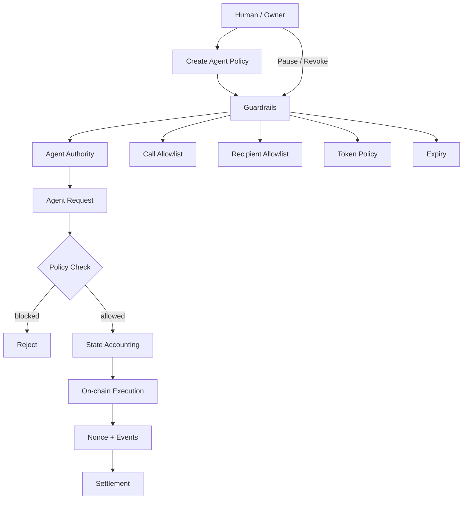
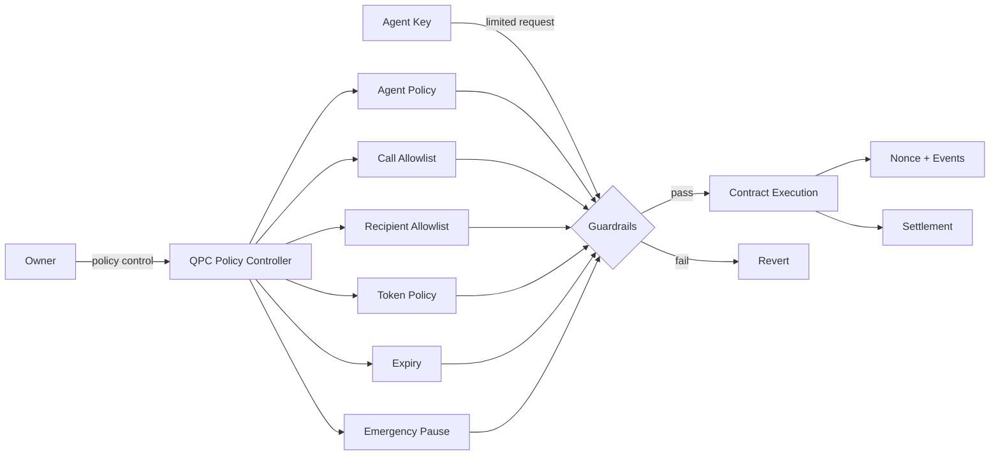

# QPC --- QUANTUM PERSISTENCE CONTRACT

<div align="center">

**Policy-Controlled Agentic Finance Infrastructure**

**Human intent → Policy → Agent execution → On-chain settlement → Audit**

</div>

---

## About

QPC Agent Finance is a standalone smart-contract foundation for autonomous and AI-assisted finance.

The core principle is simple:

> **The agent may execute within a policy, but the agent never becomes the owner.**

The contract separates **human authority** from **agent execution authority**. Policies define what an agent can do, how much it can spend, where it can send funds, which contract functions it can call, and when its authority expires.


## Core workflow



### Execution path

**Configure → Activate → Request → Validate → Account → Execute → Emit event**

1. Owner configures an agent.
2. Agent receives limited authority.
3. Agent submits an execution request.
4. Contract checks expiry, pause state, target, selector, exact calldata hash, recipient and spending limits.
5. Spending accounting is updated.
6. The approved call or token transfer executes.
7. Nonce and event data provide an on-chain execution trail.
8. Owner can pause or revoke authority at any time.

---

## Security architecture



### Security boundaries

| Layer | Responsibility |
|---|---|
| Owner | Creates, changes, pauses and revokes policies |
| Agent | Requests permitted execution only |
| Policy | Defines limits and permissions |
| Contract | Enforces policy deterministically |
| Nonce | Provides monotonic execution sequencing |
| Events | Provide an on-chain audit trail |
| Pause | Emergency global execution stop |
| Expiry | Automatic authority termination |
| Reentrancy guard | Prevents nested execution |

AI logic is **not trusted as a security boundary**. The smart contract remains the final enforcement layer.

---

## Project structure

```
qpc_contracts/
├── contracts/
│   └── QPCAgentFinance.sol       # Core policy + execution contract
│
├── test/
│   ├── QPCAgentFinance.security.t.sol
│   │                              # Security regression tests
│   ├── QPCAgentFinance.invariant.t.sol
│   │                              # State/invariant checks
│   └── QPCAgentFinance.stateful.t.sol
│                                  # Stateful handler scenarios
│
├── near/\n│   └── qpc-near-agent-finance/    # NEAR Rust policy contract MVP\n├── agent-router/                  # Local-only cross-chain request preparation\n├── zcash/                         # Shielded wallet adapter boundary\n├── script/                        # Deployment scripts
├── foundry.toml                   # Foundry compiler/test configuration
├── README.md                      # Architecture + usage overview
└── ARCHITECTURE.md                # Detailed system design
```

The repository keeps the **security-critical policy layer small and isolated**. Application-specific agents, APIs, wallets and protocol adapters can be built above it later without changing the core security model.

---

## Policy model

### Native assets

Each agent receives:

- maximum policy duration: **30 days**
- total native spending cap
- per-transaction native limit
- active / revoked state

### ERC-20 assets

Each agent/token pair can define:

- cumulative token cap
- per-transaction token limit
- cumulative spending accounting

### Contract calls

Calls require an explicit:

**agent + target + function selector + exact calldata hash**

allowlist entry.

### Token recipients

Token transfers require an explicit:

**agent + recipient**

allowlist entry.

---

## Owner lifecycle

```
Create Policy
     ↓
Activate Agent
     ↓
Agent Executes
     ↓
 ┌───────────────┐
 │ Active Policy │
 └───────────────┘
     ↓
  Pause / Revoke / Expire
     ↓
Authority Ends
```

The owner remains the root authority throughout the lifecycle.

---

## Agent execution lifecycle

```
Agent
  │
  ▼
Request
  │
  ▼
Is active?
  │ no ─────► Revert
  │ yes
  ▼
Is paused?
  │ yes ────► Revert
  │ no
  ▼
Policy validation
  │
  ├── expiry
  ├── target + selector
  ├── recipient
  ├── per-tx limit
  └── cumulative cap
  │
  ▼
Accounting
  │
  ▼
On-chain call
  │
  ▼
Nonce + event
  │
  ▼
Settlement
```

---

## Security status

Current defenses include:

- two-step ownership transfer
- agent expiry
- native spending caps
- native per-transaction limits
- ERC-20 spending caps
- ERC-20 per-transaction limits
- target/function-selector allowlisting
- exact calldata-hash allowlisting for every agent call
- rejection of common ERC-20 allowance-granting selectors (`approve`, `increaseAllowance`, `permit`)
- recipient allowlisting
- emergency pause
- monotonic nonce
- reentrancy protection
- defensive ERC-20 transfer handling
- policy validation
- security regression tests
- invariant/stateful test scaffolding

This repository has **not been independently audited**. Passing local or CI tests does not constitute a security audit. Production funds should not be deployed until independent review, fuzzing, static analysis and deployment validation are complete.

---

## Development

```bash
forge build
forge test
```

The intended development loop is:

**Change → Build → Security tests → Invariant/stateful tests → Review → Deploy**

---

## Future application layer

The core contract intentionally does not contain protocol-specific logic.

A future application can sit above it:

```
User / AI Agent
      │
      ▼
Application / API
      │
      ▼
Policy Builder
      │
      ▼
QPCAgentFinance
      │
      ├── DEX
      ├── Lending
      ├── Payments
      └── Other protocols
```

This keeps integrations replaceable while the security boundary remains centralized in the QPC contract.

---

<div align="center">

**Policy first. Agent second. Settlement last.**

</div>


## QPC design principles and security requirements

These principles define the intended system architecture. They are **design requirements**, not claims that every capability is already implemented.

### 1. Quantum Persistence: post-quantum readiness

Quantum resistance is a design target. QPC must not claim post-quantum security until suitable post-quantum cryptography is implemented, interoperable with the relevant chain adapters, and tested.

Required work includes:
- define cryptographic agility and versioned identity/authorization formats;
- evaluate standardized post-quantum signature and key-establishment algorithms against the threat model;
- design a carefully reviewed hybrid classical + post-quantum migration path where chain capabilities permit;
- define key rotation, compromise recovery, downgrade prevention, and algorithm deprecation;
- test cross-chain verification, serialization, resource limits, and failure handling.

**Current status:** post-quantum signatures, hybrid authentication, PQ key establishment, and PQ recovery are not implemented or active. Hashing and nonce checks do not make a system quantum-resistant.

### 2. Comprehensive cybersecurity

The security model must protect the complete authorization-to-settlement lifecycle, not only the smart contract call. Threat coverage must include:

- stolen agent credentials, forged or unauthorized requests, and privilege escalation;
- replay across agents, chains, contracts, assets, and policy versions;
- parameter substitution, including recipient, amount, asset, destination, fees, calldata, and expiry;
- reentrancy, malicious tokens/contracts, allowance abuse, integer/serialization edge cases, and policy mutation;
- compromised or unavailable RPCs, routers, relayers, signers, light clients, and proof providers;
- chain reorganizations, finality disagreements, duplicate delivery, timeout, partial failure, and refund/reconciliation paths;
- key rotation/revocation, emergency pause, monitoring, and incident recovery.

Each adapter must enforce its own chain-specific threat model and finality rules. Tests, fuzzing, invariant checks, static analysis, independent review, and operational controls are required; CI success alone is not an audit.

### 3. Private on-chain and private agentic operation

Privacy is an end-to-end requirement across:
- **identity:** minimize public linkage between human owners, agent identities, and wallets;
- **authorization:** disclose only the policy facts needed to authorize an action, using suitable cryptographic proofs where supported;
- **communication:** authenticate and protect agent-to-agent messages, prevent replay, and minimize metadata leakage;
- **settlement:** use chain-native privacy mechanisms where available and verify their receipts without silently falling back to public transfers.

A hidden recipient reference, encrypted off-chain message, or hash by itself does not make public chain state private. Public chains expose varying combinations of calldata, state, events, transaction timing, and network metadata. Zcash shielded transfers have a distinct UTXO and note model; they must not be represented as EVM smart-contract calls.

**Current status:** the NEAR MVP records an authorization event and is not a private NEAR execution layer. The current Zcash work is an adapter prototype and does not yet construct, sign, broadcast, or independently verify a shielded payment.

### 4. Multi-L1 adapters, not a universal contract

QPC is intended to support independent adapters with a shared authorization intent format and chain-specific enforcement. It must not assume that one smart contract or one finality model works on every network.

| Network | Adapter model | Chain-specific security responsibilities |
|---|---|---|
| NEAR | NEAR Rust contract and NEAR transaction adapter | account/function-call authorization, access control, nonce, gas, receipt and finality verification |
| Ethereum | EVM contract and transaction adapter | EVM call/value policy, chain ID, nonce, calldata, token behavior, confirmations/finality |
| BSC | EVM-compatible adapter, separately configured | BSC chain ID, RPC/finality assumptions, token and contract policy; do not infer safety solely from EVM compatibility |
| Solana | Solana program/client adapter | program IDs, instruction/account constraints, signer and PDA rules, recent blockhash/replay handling, commitment/finality |
| Zcash | Shielded UTXO wallet and light-client adapter | Unified Address/network validation, shielded note handling, nullifier/replay controls, witness/consensus and shielded receipt verification |

**Current status:** NEAR has an authorization-contract MVP; EVM has the existing Solidity policy contract; Zcash has a wallet/adapter prototype. Production-grade, independently verified adapters and settlement are not yet complete for all listed networks. Ethereum, BSC, and Solana must not be presented as integrated merely because an adapter is planned.

### 5. One authorization bound across networks

Every cross-network action must be represented by one canonical, versioned authorization intent. At minimum, its signed or otherwise cryptographically authenticated commitment must bind:

- authorization/intent ID and agent identity;
- source chain, source account, destination chain, and destination account or privacy-preserving recipient commitment;
- asset identifier on each chain, amount, decimals, and any conversion/fee limits;
- exact action and permitted parameters;
- nonce and replay domain, including chain/contract/adapter identity;
- policy ID and policy version;
- issue time, expiry/deadline, and cancellation/revocation state;
- settlement condition and required evidence type;
- transaction/receipt identifier and verified settlement evidence when settlement occurs.

Adapters must validate the same intent commitment against their own chain-specific rules. A destination transaction must not be accepted if any bound field changes, if the intent is expired or revoked, or if its nonce/replay domain has already been consumed. Source and destination identifiers, amounts, and asset mappings must be explicit; no adapter may silently reinterpret them.

A transaction hash supplied by an agent or relayer is not proof of settlement by itself. The receiving side must independently verify the appropriate chain receipt/finality or shielded proof before marking an intent settled. Timeout, reorg, partial completion, and refund states must be explicit and idempotent.

**Current status:** the existing NEAR MVP binds a limited Zcash Testnet payment intent and records authorization only. It does not yet implement the complete cross-L1 authorization envelope, cross-chain proof verification, atomic settlement, or refund protocol. Do not treat the full one-authorization model as active until those components are implemented and tested.

---

## Privacy and quantum-resistance status

The name **Quantum Persistence Contract** describes the project's direction, not a currently achieved cryptographic guarantee.

- The current EVM contract is public-chain software. Contract storage, calldata, transaction metadata, and emitted events are observable; the contract does not provide private on-chain execution by itself.
- No post-quantum signature, key-encapsulation mechanism, hybrid classical/PQ authentication, or PQ key-rotation/recovery protocol is implemented in this repository's current contract.
- The current cross-chain work is a prototype boundary, not a universal L1 network. A NEAR Rust authorization-contract MVP exists, but it is not deployed or production-ready; production adapters for all L1s are not yet implemented.
- The Zcash adapter currently provides address/policy validation, local wallet database initialization, replay protection, and a read-only lightwalletd probe. It does not yet scan shielded notes, construct/sign/broadcast payments, or independently prove shielded receipts.

Do not describe QPC as quantum-resistant, private-on-chain, a live bridge, or production-ready until those capabilities are implemented and independently reviewed.


## NEAR contract status

A NEAR Rust policy-contract MVP now lives in near/qpc-near-agent-finance. It checks agent authorization, router binding, policy version, nonce, expiry, payment-argument hash, and spending caps before recording an authorization event. It does not execute a Zcash payment, call a router, or prove settlement. It has not been deployed to NEAR Testnet or independently audited. See that crate's README and the NEAR contract CI workflow.
